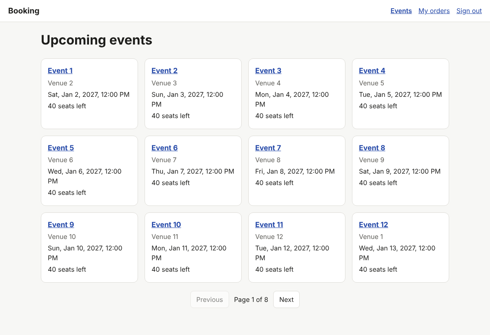
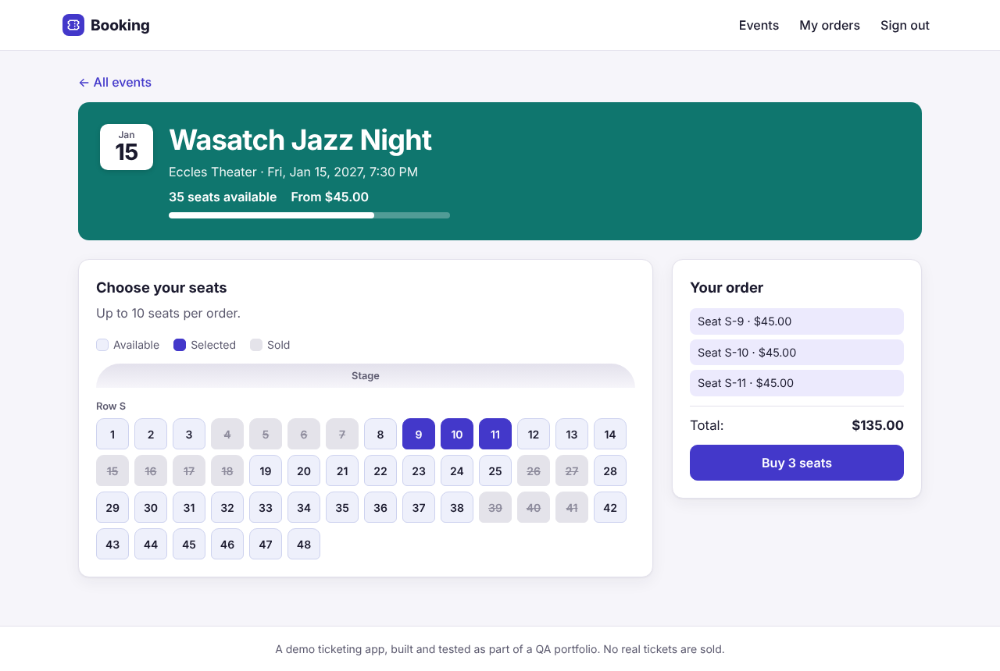
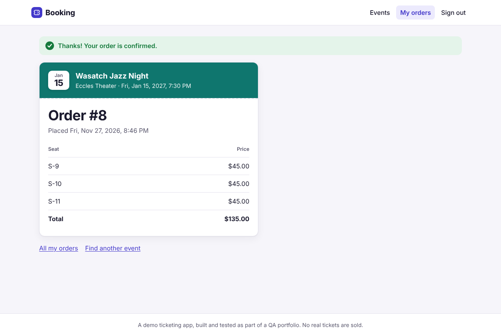

# booking-web

[](https://github.com/Kurtis-H/booking-web/actions/workflows/ci.yml)
[](https://github.com/Kurtis-H/booking-web/actions/workflows/codeql.yml)

A React and TypeScript web app for buying event seats. It is the front end for the booking API in [api-performance-lab](https://github.com/Kurtis-H/api-performance-lab), and the web target for the Playwright and Cypress side of my test framework comparison.

| Browse events | Pick seats | Confirmation |
|---|---|---|
|  |  |  |

## What it does

* Browse upcoming events, a page at a time, with how many seats are left.
* Pick up to 10 seats on a seat map and see the running total.
* Buy them and get a confirmation; see your past orders.
* Handle the things that go wrong in real ticketing:
  * **Someone else buys your seat first (409):** explain, refresh the seat map and clear the selection.
  * **Rate limited (429):** say how long to wait (from `Retry-After`) and keep the selection.
  * **Session ended (401)**, **missing event or order (404)**, **network failure**: a clear message every time, never a blank screen.
* Keyboard and screen-reader friendly: every seat is a labeled toggle button ("Seat R2-5, $30.00", `aria-pressed`), rows are grouped, errors are announced.

## How it's tested

| Layer | Tool | What it checks |
|---|---|---|
| Unit | Vitest | Seat selection rules (10-seat limit, totals, rows), money and date formatting, error messages, the API client |
| Component | Vitest + Testing Library + MSW | Every page through the whole app, against an in-memory fake of the API that follows the real API's rules (401, 404, 409) |
| End to end | Playwright, desktop and mobile | The built app against the **real** API and Postgres: buy seats, lose a seat to another buyer, can't read someone else's order |
| Accessibility | axe-core in Playwright | No WCAG 2.1 A/AA violations on any main screen, plus a keyboard-only purchase |
| Contract | openapi-typescript | Types are generated from the API's OpenAPI spec. CI regenerates them from the live API and fails if the API has changed shape |
| Consumer contract | Pact | What this app needs from the API: 9 interactions recorded through the app's own client, including the 401, 404 and 409 it handles. The API's CI replays them (see below) |
| Static | TypeScript strict, ESLint (incl. jsx-a11y), CodeQL, npm audit | |

Unit and component tests need 80% coverage to pass (currently about 98% of lines). Tests use roles and accessible names first (`getByRole("button", { name: "Buy 2 seats" })`), and `data-testid` only for things with no natural role, like the order summary.

Each end-to-end test creates its own event through the API's admin endpoint, so tests can run in parallel and never fight over seats.

## Run it

You need Node 22 and the booking API running. From a checkout of api-performance-lab:

```bash
scripts/serve.sh   # seeds Postgres and starts the API on :8000
```

Then here:

```bash
npm ci
npm run dev                  # http://localhost:5173, /api is proxied to :8000
npm test                     # unit + component tests
npx playwright install chromium
npm run e2e                  # builds, serves on :4173 and runs Playwright
npm run api:types            # regenerate src/api/schema.d.ts from the API
```

Sign in with an API key from the seed data (`key-user-1` ... `key-user-200`), or use the demo account button. These keys are public test data.

## CI

Every push and pull request runs:

* **Lint, types and unit tests:** ESLint, `tsc`, Vitest with coverage, the Pact consumer contract (and a check that the committed contract is current), build, `npm audit`
* **Contract holds against the current API:** this branch's Pact contract, verified by api-performance-lab's provider test
* **End-to-end against the real API:** installs api-performance-lab, starts Postgres and the API, runs Playwright on desktop and mobile
* **Types match the API's OpenAPI spec:** regenerates the types from the running API and fails on any difference
* **CodeQL** for the TypeScript and the workflows; Dependabot for npm and Actions

## Layout

```
src/api/        typed client; schema.d.ts is generated from the API spec
src/lib/        pure logic: seat selection, formatting, error messages
src/pages/      one file per screen, each with its .test.tsx
src/components/ layout, seat map, loading and error states
src/test/       MSW fake API and test helpers
e2e/            Playwright specs and fixtures
```

## Consumer contract

[`contract/booking-api.pact.test.ts`](contract/booking-api.pact.test.ts) records each call the app makes, through `src/api/client.ts`, against Pact's mock server, and writes [`pacts/booking-web-booking-api.json`](pacts/booking-web-booking-api.json). It holds only the fields the app reads, so the API can add fields or change ones the app ignores.

It's checked from both sides:

* [api-performance-lab](https://github.com/Kurtis-H/api-performance-lab) checks out this repo and replays the committed file against the real API on every change, so an API change that would break this app fails the API's own pull request.
* This repo's **Contract holds against the current API** job generates the contract from the branch and runs the API's own provider test on it, so a contract change here is verified before it's merged.

Provider states such as "an event with available seats exists" create their data on the API side and hand back the real ids.

```bash
npm run test:contract     # regenerates pacts/; CI fails if the committed file differs
```

## Planted bug for test-sensitivity runs

[framework-showdown](https://github.com/Kurtis-H/framework-showdown) needs to prove its suites can fail. Building with `VITE_PLANTED_BUG=total` switches on one bug in [`src/lib/plantedBug.ts`](src/lib/plantedBug.ts): the order total counts only the first seat. It's off unless that variable is set at build time, and a unit test covers both settings.
